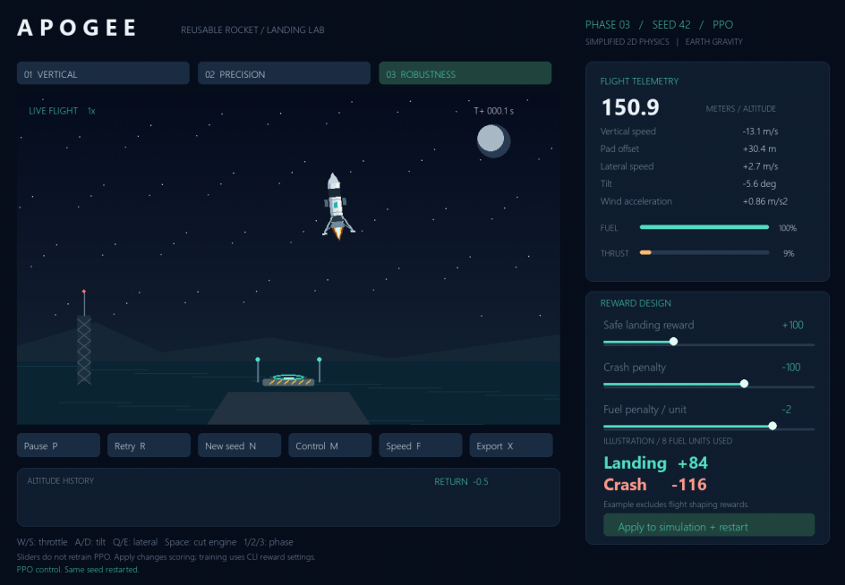
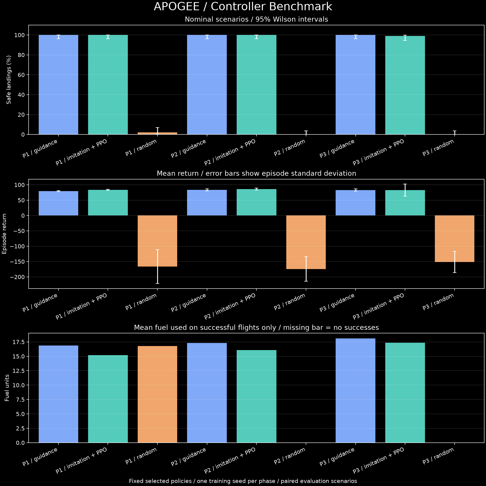
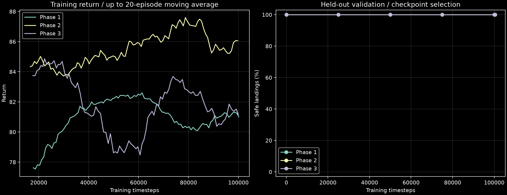
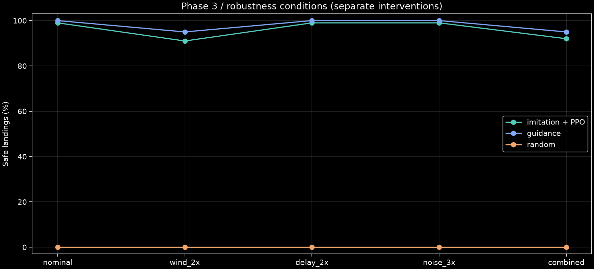
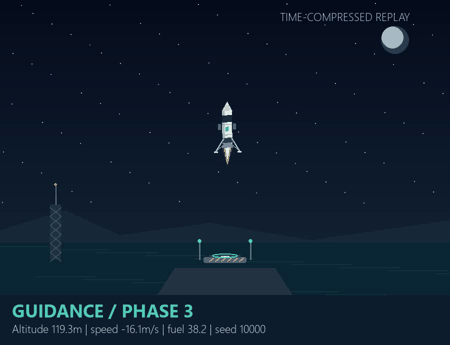

# APOGEE | Rocket Landing Lab

**A reproducible rocket-control experiment with an interactive flight dashboard.**

Custom Gymnasium physics, learned neural control, PPO training, reference guidance, and honest controller comparisons in one Python project.



[Experiment protocol](docs/EXPERIMENTS.md) | [Model card](docs/MODEL_CARD.md) | [Measured results](docs/benchmark/REPORT.md) | [Offline dashboard](docs/benchmark/dashboard.html) | [Demo recording](docs/apogee_demo.mp4) | [MIT license](LICENSE)

## Run the simulator

From the project folder, use the existing virtual environment:

```powershell
.\venv\Scripts\python.exe app.py
```

For a fresh Windows setup with Python 3.10 or newer:

```powershell
python -m venv venv
.\venv\Scripts\python.exe -m pip install -r requirements.txt
.\venv\Scripts\python.exe app.py
```

The full interpreter path avoids PowerShell activation restrictions and accidental use of another Python installation. On Linux/macOS, replace `.\venv\Scripts\python.exe` with `./venv/bin/python`.

The application works without a model in **GUIDANCE** and **MANUAL** modes. Compatible custom checkpoints unlock **PPO**, the UI label for the learned Stable-Baselines3 policy. Its actual training method and selection step are recorded in JSON metadata and the experiment report. Guidance is a PD reference controller; it is not trained AI.

## What the project demonstrates

| Area | Implementation |
| --- | --- |
| Custom control environment | Continuous main throttle, gimbal torque, lateral thrust, finite fuel, changing mass, and safe-touchdown constraints |
| Progressive difficulty | Randomized vertical descent, horizontal precision, and advanced wind/delay/noise conditions |
| Interactive visualization | Procedural booster, engine plume, landing legs, illuminated coastal pad, trajectory, telemetry, and altitude history |
| Reward experimentation | Adjustable landing/crash/fuel weights with a live illustrative calculator |
| Learning workflow | Optional expert-labeled imitation warm start, PPO updates, held-out validation, and best/final checkpoints |
| Reproducible evaluation | Paired seeds, random and guidance baselines, per-flight CSVs, confidence intervals, and checkpoint/source hashes |
| Results presentation | Exported plots and an offline HTML dashboard with phase/scenario filters |
| Engineering | Automated regression tests, GitHub Actions workflow, maintainable dependency lists, and an MIT license |

## Measured results

<!-- BENCHMARK_START -->
| Phase | Controller | Episodes | Safe landings (95% CI) | Mean return | Fuel / successful flight |
| --- | --- | --- | --- | --- | --- |
| 1 | guidance | 100 | 100% (96.3%-100.0%) | +79.45 | 16.89 |
| 1 | Imitation + PPO | 100 | 100% (96.3%-100.0%) | +83.24 | 15.21 |
| 1 | random | 100 | 2% (0.6%-7.0%) | -166.38 | 16.78 |
| 2 | guidance | 100 | 100% (96.3%-100.0%) | +83.42 | 17.32 |
| 2 | Imitation + PPO | 100 | 100% (96.3%-100.0%) | +86.39 | 16.07 |
| 2 | random | 100 | 0% (0.0%-3.7%) | -174.40 | N/A |
| 3 | guidance | 100 | 100% (96.3%-100.0%) | +82.92 | 18.10 |
| 3 | Imitation + PPO | 100 | 99% (94.6%-99.8%) | +82.56 | 17.37 |
| 3 | random | 100 | 0% (0.0%-3.7%) | -151.44 | N/A |

Nominal conditions; one training seed per phase. Intervals condition on the fixed selected policy. The learned policies use reference-generated imitation labels before PPO updates. Successful-flight fuel compares potentially different successful subsets.

Phase 1: behavior cloning + PPO; selected checkpoint at 50,000 PPO steps of 100,352 trained.
Phase 2: behavior cloning + PPO; selected checkpoint at 75,000 PPO steps of 100,352 trained.
Phase 3: behavior cloning + PPO; selected checkpoint at 100,000 PPO steps of 100,352 trained.
<!-- BENCHMARK_END -->

The full [report](docs/benchmark/REPORT.md) includes all stress conditions. [Per-episode data](docs/benchmark/episodes.csv) and the [reproducibility manifest](docs/benchmark/manifest.json) support the reported numbers. No result should be described as a safety certification or a guarantee of real-world rocket performance.





## Demo

[Watch the 75-second MP4](docs/apogee_demo.mp4). It compares reference guidance, a learned policy, and random actions on one paired scenario, retaining the actual outcomes. Flights are explicitly time-compressed.



A single demo flight is illustrative. Use the benchmark to discuss reliability. The recording's [JSON sidecar](docs/apogee_demo.json) includes the seeds, outcomes, scores, fuel usage, frame count, and duration. See [recording instructions](docs/DEMO.md) to regenerate it.

## Controls

| Key or button | Action |
| --- | --- |
| `1` / `2` / `3` | Select vertical / precision / robustness phase |
| `M` | Cycle guidance, manual, and available learned control |
| `W` / Up; `S` / Down | Increase / decrease manual throttle |
| `A` / `D`, or Left / Right | Gimbal the engine and tilt the rocket |
| `Q` / `E` | Fire left / right lateral thrusters |
| Space | Command engine cutoff; advanced engine lag still applies |
| `P` | Pause or resume |
| `R` / `N` | Retry the same seed / select the next seed |
| `F` | Cycle automated playback: 1x, 2x, 4x |
| `X` | Export completed dashboard flights to `results/` |
| Esc | Exit the dashboard or visual evaluation |

Phase tabs and flight buttons support mouse input. The dashboard scales to smaller displays and supports resizing. Manual flight always runs at 1x. Switching phase or control mode resets the flight; abandoned flights are excluded from exports. Reselect the phase or restart the application to load a newly trained model.

## Three environment phases

| Phase | Conditions |
| --- | --- |
| 1 - Vertical | Random starting altitude and descent speed, Earth-like gravity, adjustable main thrust, finite fuel, and changing mass. Horizontal motion is disabled. |
| 2 - Precision | Also random horizontal starts, lateral velocity, tilt, gimbal rotation, damping, side thrusters, and a narrow landing platform. |
| 3 - Robustness | Also random initial lateral speed and tilt, gravity and thrust variation, per-episode wind acceleration, engine lag, and noisy sensor observations. |

All phases vary initial altitude and vertical speed across seeds. Retrying a seed with the same action sequence reproduces the scenario and sensor draws. This randomized-start protocol is versioned as `RocketEnv-v2`; older v1 checkpoints require retraining for the current benchmark.

## Train and select a learned policy

The portfolio configuration uses imitation followed by PPO. Each phase trains independently:

```powershell
.\venv\Scripts\python.exe train.py --config configs/guided_training.json --phase 1
.\venv\Scripts\python.exe train.py --config configs/guided_training.json --phase 2
.\venv\Scripts\python.exe train.py --config configs/guided_training.json --phase 3
```

The warm start uses 32 reference flights and 32,000 expert-labeled sampled states. It is followed by 100,000 requested PPO steps. Expert labels are generated during training; the reference controller is not called during learned-policy evaluation. This is not learning entirely from trial and error.

For a **PPO-only** experiment without imitation:

```powershell
.\venv\Scripts\python.exe train.py --config configs/training.json --phase 1 --output models/ppo_only_phase1
```

Optional curriculum warm starts are supported through `--resume`, for example `--phase 2 --resume models/rocket_phase1.zip`. They were not used for the independently trained published guided runs.

The trainer evaluates held-out validation seeds, selects by safe-landing rate and then mean reward, and saves:

- `models/rocket_phaseN.zip` and `.json`: selected checkpoint and provenance.
- `models/rocket_phaseN_final.zip` and `.json`: final policy, retained even if selection preferred an earlier one.
- `models/rocket_phaseN.monitor.csv`: training episode returns and lengths.
- `models/rocket_phaseN.validation.json`: validation history.

Step 0 is eligible for selection after imitation. If it wins, report that policy as an imitation warm start, not an improvement from PPO. Requested timesteps round up to complete PPO rollouts. Metadata records actual steps, training method, versions, seeds, and configuration. Default output replaces that phase's artifacts; use `--output` for separate experiments.

View live training metrics:

```powershell
.\venv\Scripts\python.exe -m tensorboard.main --logdir logs
```

## Reproduce the benchmark

```powershell
.\venv\Scripts\python.exe benchmark.py --update-readme
```

The default [configuration](configs/benchmark.json) evaluates 100 held-out seeds per controller and condition. Nominal comparisons cover all three phases. Phase 3 additionally tests 2x wind, 2x engine delay, 3x sensor noise, and their combination: **2,100 flights across 21 groups**.

The benchmark uses matching seeds and reward weights for PPO, guidance, and independent uniform random actions. It exports `episodes.csv`, `summary.csv`, `summary.json`, a provenance manifest, plots, a Markdown report, and `dashboard.html` under `docs/benchmark/`. Open the HTML file locally; it needs no server or network connection. It is a generated report artifact, not a hosted service.

The separate [PPO-only baseline](docs/baselines/REPORT.md) is reproducible with:

In the measured phase-1 PPO-only baseline, the selected policy achieved **0/100 safe landings** after a 300,000-step training budget, versus **100/100** for guidance and **2/100** for random actions. This failed baseline is retained rather than hidden; guided training uses extra expert knowledge and should not be described as a like-for-like improvement in pure reinforcement learning.

```powershell
.\venv\Scripts\python.exe benchmark.py --phases 1 --model-dir models/baselines --output docs/baselines
```

A quick pipeline check can use `--episodes 2 --phases 1 --controllers guidance random --output results/smoke`. Rebuild plots without rerunning flights using `python report.py --input docs/benchmark` with the project interpreter.

### Interpreting results

Safe-landing intervals are 95% Wilson intervals over evaluation episodes for a fixed checkpoint. They do not quantify variability across retraining seeds; these runs use one training seed. Reward error bars show standard deviation. Fuel plots condition on successful flights so that early crashes are not rewarded for using less fuel; different controllers may succeed on different subsets.

Training seed 42, imitation-flight seeds 1000-1031, validation seeds 5000-5009, and benchmark seeds 10000-10099 are separated. The benchmark manifest includes actual configurations and checkpoint hashes. See [EXPERIMENTS.md](docs/EXPERIMENTS.md) for the complete protocol, distribution shifts, and limitations.

## Evaluate one controller and export CSV

```powershell
.\venv\Scripts\python.exe test.py --phase 3 --headless --episodes 100 --seed 10000 --csv results/guidance.csv
.\venv\Scripts\python.exe test.py --phase 3 --controller ppo --headless --episodes 100 --seed 10000 --csv results/ppo.csv
.\venv\Scripts\python.exe test.py --phase 3 --controller random --headless --episodes 100 --seed 10000 --csv results/random.csv
```

Guidance is the default. Specifying `--model models/experiment.zip` automatically selects learned control. Evaluation checks metadata and uses the checkpoint's reward settings. Omit `--headless` to watch; Esc or closing the window stops cleanly and retains completed flights.

`--csv` requires a file path. Quote paths with spaces, for example `--csv "results/flight scores.csv"`. Parent folders are created; relative paths use the terminal's current directory. A valid evaluation replaces an existing output file. Rows are flushed after completed flights. Columns include seed, phase, controller, return, outcome, fuel used, and steps; dashboard and benchmark exports add experiment settings.

## Reward design

The illustrative calculator uses the landing bonus, crash penalty, and per-unit fuel penalty. With eight fuel units used, defaults give `100 - 2*8 = +84` for a landing and `-100 - 2*8 = -116` for a crash.

Sliders immediately update the calculator. **Apply to simulation + restart** changes flight scoring. It does not retrain a policy or modify reference guidance. To learn with different rewards:

```powershell
.\venv\Scripts\python.exe train.py --config configs/guided_training.json --phase 1 --landing-reward 150 --crash-penalty -150 --fuel-penalty -1 --output models/reward_experiment
```

Actual return also includes potential-difference shaping for position, speed and tilt, and a `-0.01` per-step cost. Timeout/out-of-bounds receive the crash penalty. Compare landing rate as well as reward: inappropriate weights can favor unsafe fuel savings.

## Physics and scope

`RocketEnv` implements Gymnasium's seeded reset and five-value step API. A step is 0.02 seconds, with a 50-second time limit. All phases share three continuous actions in `[-1,1]`: main throttle mapped to `[0,1]`, gimbal, and lateral thrust. Eleven normalized observations cover position, velocities, attitude, angular rate, fuel, actual throttle, wind, gravity, and thrust acceleration.

Nominal parameters are 1,000 kg dry mass, 40 fuel units, 22 kN thrust, and 9.81 m/s2 gravity. Safe contact requires center offset <=9 m, vertical speed <=3 m/s, lateral speed <=2 m/s, tilt <=0.12 rad, and angular rate <=0.2 rad/s. Both engine types stop when fuel is exhausted. Wind is fixed within an advanced episode; engine lag is first-order throttle response. The UI displays true state while advanced controllers receive noisy observations.

This is an educational 2D simulator. It omits drag, atmospheric/orbital effects, detailed engine behavior, and structural contact dynamics. Rocket artwork is enlarged for readability. The reference controller supplies privileged training labels in guided runs, and the baseline comparisons do not establish algorithm-level superiority or real-flight reliability.

## Verification and automation

```powershell
.\venv\Scripts\python.exe -m unittest discover -p "test_*.py" -v
```

Tests cover physics, reproducibility, randomized starts, fuel exhaustion, landing thresholds, rewards, engine lag, time limits, Gymnasium compatibility, CSV paths, invalid checkpoints, graceful window closure, resized mouse input, Wilson intervals, conditional fuel statistics, and paired stress scenarios.

The [GitHub Actions workflow](.github/workflows/checks.yml) runs compilation, regression tests, and a small benchmark on Python 3.11 and 3.13. Hosted execution starts after the repository is pushed to GitHub; local validation is recorded separately.

## Project map

```text
app.py / rocket_visuals.py   Interactive dashboard and procedural scene
rocket_env.py               Physics, rewards, conditions, and guidance
checkpoints.py              Versioned policy/metadata validation
train.py / test.py          Training and individual-controller evaluation
benchmark.py / report.py    Paired experiments, statistics, plots, offline report
record_demo.py              Reproducible MP4 and GIF generation
configs/                    Plain PPO, guided training, and benchmark settings
test_*.py                   Physics and workflow regression tests
models/                     Selected/final checkpoints and training histories
docs/                       Protocol, measured data, reports, plots, and recording
results/ / logs/            Ignored local exports and TensorBoard data
```

`requirements.txt` contains the maintained core dependencies; `requirement.txt` remains a compatibility alias. Optional recording dependencies are in `requirements-demo.txt`. `requirements-legacy.txt` enables the original LunarLander demo (`lunar_app.py`); its `models/rocket_ai.zip` is incompatible with the custom environment. `requirements-local.txt` preserves the previous local package inventory, including optional packages; use the maintained lists for fresh installations.

## Troubleshooting

| Symptom | Fix |
| --- | --- |
| Missing packages or unresolved VS Code imports | Select `venv\Scripts\python.exe` with **Python: Select Interpreter**; install through that interpreter. A global/Laragon Python can have different packages. |
| PowerShell blocks activation | Use the full interpreter commands above; activation is optional. |
| `--csv` expects an argument | Supply an output filename, not just the flag or a directory. |
| Cannot write CSV | Choose a writable file, quote spaces, and close the output in Excel if locked. |
| Missing/wrong/old checkpoint | Train that phase and keep matching `.zip` and `.json` files together. v1 and LunarLander models require retraining; guidance/manual modes remain usable. |
| Recording dependency/encoder missing | Install `requirements-demo.txt` and choose a writable `.mp4` path. The recording instructions describe codec compatibility. |
| Box2D fails to install | It is only needed for the legacy LunarLander demo; Windows builds may need SWIG/C++ tools when wheels are unavailable. |
